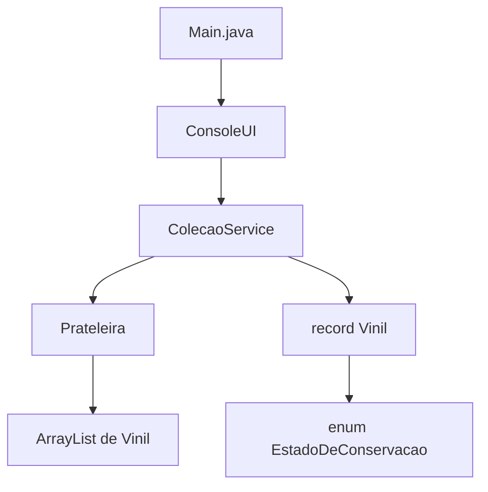

<div align="center">

# C O L E Ç Ã O　D E　V I N I S　//　J A V A

### `JAVA • POO • RECORDS • ENUM • CONSOLE`

**Gerenciador de coleção de discos de vinil desenvolvido em Java, com arquitetura separada em camadas.**


`FATEC • ADS`　·　`JAVA CORE`　·　`PROJETO ACADÊMICO`

[Visão geral](#visao-geral) · [Funcionalidades](#funcionalidades) · [Arquitetura](#arquitetura) · [Execução](#execucao)

</div>

---

<a id="visao-geral"></a>

## `PROJECT // VISÃO GERAL`

O **ColecaoVinis.java** organiza uma coleção de discos por **título, artista, ano de lançamento e estado de conservação**. A interação ocorre inteiramente no **terminal**, usando `Scanner` e um menu numérico. Os dados ficam armazenados em uma `ArrayList` durante a execução — **não há banco de dados nem persistência entre execuções**.

A estrutura divide as responsabilidades entre a **UI de console**, o **serviço de coleção**, o **repositório em memória** e os **modelos Java**.

<a id="funcionalidades"></a>

## `SYSTEM // FUNCIONALIDADES`

| Operação | Implementação |
| :--- | :--- |
| `01` Cadastrar vinil | Valida título, artista, ano e conservação |
| `02` Procurar vinil | Busca por título, ignorando maiúsculas/minúsculas |
| `03` Mostrar vinis | Lista todos os discos cadastrados |
| `09` Sair | Encerra o menu |
| Estado de conservação | `NOVO`, `EXCELENTE`, `USADO`, `RARO`, `DANIFICADO` |
| Proteção da listagem | Retorno com `List.copyOf()` |
| Retorno de busca | `Optional<Vinil>` |

> **Escopo real:** o código atual não implementa atualização, exclusão nem salvamento permanente de discos.

<a id="arquitetura"></a>

## `ARCHITECTURE // FLUXO DE CAMADAS`



## `STRUCTURE // ARQUIVOS`

```text
ColecaoVinis.java/
├── Main.java
├── model/
│   ├── Vinil.java
│   └── EstadoDeConservacao.java
├── repositorio/
│   └── Prateleira.java
├── service/
│   └── ColecaoService.java
├── ui/
│   └── ConsoleUI.java
├── NOVAS FUNÇÕES.md
└── README.md
```

| Camada | Responsabilidade |
| :--- | :--- |
| `Main` | Conecta o scanner, repositório, service e UI |
| `model` | Representa o vinil e os estados permitidos |
| `repositorio` | Guarda e pesquisa os discos na memória |
| `service` | Centraliza cadastro, busca e listagem |
| `ui` | Apresenta o menu e recebe os dados |

<a id="execucao"></a>

## `BOOT SEQUENCE // COMO EXECUTAR`

**Pré-requisito:** JDK 17 ou superior.

```bash
git clone https://github.com/gilbertocorrea-cmd/ColecaoVinis.java.git
cd ColecaoVinis.java
```

**Atenção ao empacotamento:** os arquivos declaram o pacote Java `ProjetoVinil`, embora o repositório não tenha uma pasta física com esse nome na raiz. Compile pela raiz, gerando os arquivos `.class` em um diretório de saída:

```bash
mkdir -p out
javac -d out Main.java model/*.java repositorio/*.java service/*.java ui/*.java
java -cp out ProjetoVinil.Main
```

## `LEARNING // CONCEITOS UTILIZADOS`

`record` · `enum` · `switch` moderno · `try/catch` · `try-with-resources` · `ArrayList` · `Stream.filter` · `Optional` · `List.copyOf` · validações com `isBlank()`.

Consulte também a documentação detalhada de sintaxe: [**NOVAS FUNÇÕES.md**](NOVAS%20FUN%C3%87%C3%95ES.md).

---

<div align="center">

### `VINYL COLLECTION // CODE • LEARN • BUILD`

**Gilberto Corrêa** · Análise e Desenvolvimento de Sistemas — FATEC

[GitHub](https://github.com/gilbertocorrea-cmd)

</div>
